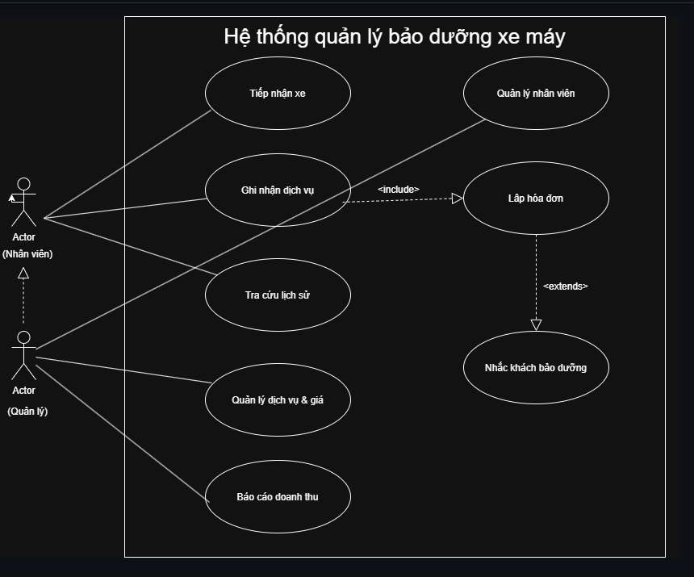
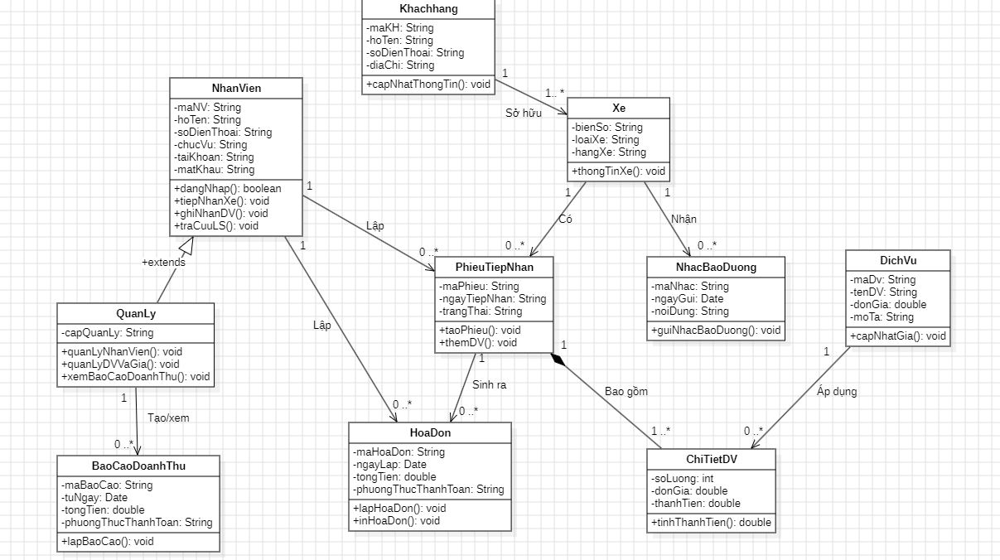
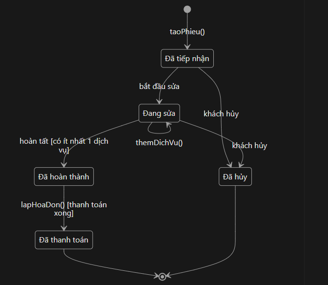

# Hệ thống quản lý cửa hàng bảo dưỡng – sửa chữa xe máy
# Nhóm 15

## 1. Danh sách thành viên

| STT | Họ và tên | MSSV |
|-----|-----------|------|
| 1   | Trần Văn Anh Khoa | 114321 |
| 2   | Trần Công Hậu | 115731 |

## 2. Mô tả yêu cầu

Phần mềm giúp cửa hàng sửa xe máy quản lý việc tiếp nhận xe, dịch vụ đã làm, hóa đơn và doanh thu, thay cho việc ghi sổ tay.

**Người dùng (actor):**
- **Nhân viên:** làm việc hằng ngày ở quầy.
- **Quản lý:** là nhân viên có thêm quyền quản trị.

**Chức năng của Nhân viên:**
- Đăng nhập vào hệ thống.
- Tiếp nhận xe: lưu thông tin khách, thông tin xe và tạo phiếu tiếp nhận.
- Ghi nhận dịch vụ đã làm cho từng xe (thay nhớt, thay lốp, ...).
- Lập hóa đơn và in hóa đơn.
- Tra cứu lịch sử sửa chữa, bảo dưỡng của xe.

**Chức năng thêm của Quản lý:**
- Quản lý nhân viên (thêm, sửa, xóa tài khoản).
- Quản lý dịch vụ và bảng giá.
- Xem báo cáo doanh thu theo khoảng ngày.

**Chức năng tự động của hệ thống:**
- Gửi nhắc bảo dưỡng cho khách khi xe đến hạn.

## 3 . Hình ảnh use-case

## 4 . Gọi phương thức Uce-case
UC01 — Tiếp nhận xe: gọi phương thức khởi tạo (constructor) của lớp PhieuTiepNhan
UC02 — Ghi nhận dịch vụ bảo dưỡng: gọi phương thức themDichVu(dv) của lớp PhieuTiepNhan
UC03 — Lập hoá đơn: gọi phương thức taoHoaDon() của lớp PhieuTiepNhan → phương thức này gọi tiếp xuatHoaDon() của lớp HoaDon
UC04 — Tra cứu lịch sử sửa chữa: gọi phương thức xemLichSu(xe) của lớp NhanVien
UC05 — Quản lý danh mục dịch vụ & giá: gọi phương thức themDichVu(dv) / suaDichVu(dv) của lớp QuanLy
UC06 — Quản lý nhân viên: gọi phương thức themNhanVien(nv) của lớp QuanLy
UC07 — Xem báo cáo doanh thu: gọi phương thức xemBaoCaoDoanhThu() của lớp QuanLy → gọi tiếp tinhTongDoanhThu() của lớp BaoCaoDoanhThu
UC08 — Nhắc khách bảo dưỡng định kỳ: gọi phương thức tinhLichNhacTiepTheo() của lớp DichVuBaoDuong (thực thi bởi lớp con tương ứng, ví dụ ThayNhot)
 
## 5. Hình ảnh class diagram
 

## 6. Mô tả các lớp và quan hệ

| Lớp | Vai trò |
|-----|---------|
| KhachHang | Thông tin chủ xe |
| Xe | Xe máy của khách, nhận diện bằng biển số |
| NhanVien | Người dùng hệ thống, có tài khoản để đăng nhập |
| QuanLy | Kế thừa NhanVien, có thêm quyền quản trị và xem báo cáo |
| PhieuTiepNhan | Mỗi lần xe vào tiệm tạo 1 phiếu |
| DichVu | Danh mục dịch vụ và giá |
| ChiTietDichVu | Từng dòng dịch vụ trong phiếu (số lượng, đơn giá, thành tiền) |
| HoaDon | Thanh toán cho 1 phiếu |
| NhacBaoDuong | Lời nhắc bảo dưỡng gửi cho xe |
| BaoCaoDoanhThu | Báo cáo tổng doanh thu theo khoảng ngày |

| Quan hệ | Ý nghĩa |
|---------|---------|
| KhachHang 1 – 1..* Xe | Một khách có ít nhất 1 xe |
| Xe 1 – 0..* PhieuTiepNhan | Một xe có thể vào tiệm nhiều lần |
| Xe 1 – 0..* NhacBaoDuong | Một xe có thể nhận nhiều lời nhắc |
| NhanVien 1 – 0..* PhieuTiepNhan, HoaDon | Nhân viên lập nhiều phiếu và hóa đơn |
| NhanVien ◁ QuanLy | Quản lý là một loại nhân viên (kế thừa) |
| PhieuTiepNhan 1 ◆– 1..* ChiTietDichVu | Phiếu bao gồm các dòng dịch vụ; xóa phiếu thì xóa luôn các dòng (composition) |
| PhieuTiepNhan 1 – 0..1 HoaDon | Phiếu sinh ra tối đa 1 hóa đơn |
| DichVu 1 – 0..* ChiTietDichVu | Một dịch vụ được áp dụng ở nhiều dòng chi tiết |
| QuanLy 1 – 0..* BaoCaoDoanhThu | Quản lý tạo và xem nhiều báo cáo |

#### 1. KhachHang
Lưu thông tin người chủ xe đến sửa hoặc bảo dưỡng.

| Thành phần | Kiểu | Ý nghĩa |
|-----------|------|---------|
| maKH | String | Mã khách hàng, không trùng nhau |
| hoTen | String | Họ tên khách |
| soDienThoai | String | Số điện thoại để liên lạc và gửi nhắc bảo dưỡng |
| diaChi | String | Địa chỉ khách |
| capNhatThongTin() | void | Sửa thông tin khách khi có thay đổi (đổi số điện thoại, địa chỉ) |

#### 2. Xe
Xe máy của khách, được nhận diện bằng biển số.

| Thành phần | Kiểu | Ý nghĩa |
|-----------|------|---------|
| bienSo | String | Biển số xe, dùng để tìm xe nhanh khi tiếp nhận |
| loaiXe | String | Loại xe (xe số, xe tay ga, ...) |
| hangXe | String | Hãng xe (Honda, Yamaha, ...) |
| thongTinXe() | void | Hiển thị thông tin xe |

#### 3. NhanVien
Người dùng hệ thống ở quầy, có tài khoản để đăng nhập.

| Thành phần | Kiểu | Ý nghĩa |
|-----------|------|---------|
| maNV | String | Mã nhân viên |
| hoTen | String | Họ tên |
| soDienThoai | String | Số điện thoại |
| chucVu | String | Chức vụ (thu ngân, thợ, ...) |
| taiKhoan | String | Tên đăng nhập |
| matKhau | String | Mật khẩu đăng nhập |
| dangNhap() | boolean | Kiểm tra tài khoản và mật khẩu; đúng trả về `true`, sai trả về `false` |
| tiepNhanXe() | void | Nhận xe vào tiệm và tạo phiếu tiếp nhận |
| ghiNhanDichVu() | void | Ghi các dịch vụ đã làm cho xe vào phiếu |
| traCuuLichSu() | void | Xem các lần sửa, bảo dưỡng trước của xe |

#### 4. QuanLy (kế thừa NhanVien)
Quản lý là một loại nhân viên. Lớp này **tự có** mọi thuộc tính và phương thức của NhanVien, chỉ khai báo thêm phần riêng.

| Thành phần | Kiểu | Ý nghĩa |
|-----------|------|---------|
| capQuanLy | String | Cấp bậc quản lý (ví dụ: chủ tiệm, quản lý ca) |
| quanLyNhanVien() | void | Thêm, sửa, xóa tài khoản nhân viên |
| quanLyDichVuVaGia() | void | Thêm dịch vụ mới, chỉnh sửa bảng giá |
| xemBaoCaoDoanhThu() | void | Xem báo cáo doanh thu |

#### 5. PhieuTiepNhan
Mỗi lần xe vào tiệm tạo 1 phiếu. Đây là lớp trung tâm, nối khách, xe, nhân viên, dịch vụ và hóa đơn.

| Thành phần | Kiểu | Ý nghĩa |
|-----------|------|---------|
| maPhieu | String | Mã phiếu |
| ngayTiepNhan | Date | Ngày xe vào tiệm |
| trangThai | String | Tình trạng phiếu (đang sửa, đã xong, đã thanh toán) |
| taoPhieu() | void | Tạo phiếu mới khi nhận xe |
| themDichVu() | void | Thêm 1 dịch vụ vào phiếu (tạo ra 1 ChiTietDichVu) |

#### 6. DichVu
Danh mục các dịch vụ của tiệm và giá chuẩn.

| Thành phần | Kiểu | Ý nghĩa |
|-----------|------|---------|
| maDV | String | Mã dịch vụ |
| tenDichVu | String | Tên dịch vụ (thay nhớt, vá lốp, ...) |
| donGia | double | Giá hiện tại của dịch vụ |
| moTa | String | Mô tả ngắn dịch vụ |
| capNhatGia() | void | Đổi giá dịch vụ |

#### 7. ChiTietDichVu
Một dòng trong phiếu, cho biết xe đã làm dịch vụ nào, bao nhiêu lần, giá bao nhiêu. Lớp này tồn tại để nối PhieuTiepNhan với DichVu, vì một phiếu có nhiều dịch vụ và một dịch vụ nằm trong nhiều phiếu.

| Thành phần | Kiểu | Ý nghĩa |
|-----------|------|---------|
| soLuong | int | Số lượng (số lần hoặc số món) |
| donGia | double | Giá **tại thời điểm làm**. Lưu riêng để sau này DichVu đổi giá thì hóa đơn cũ không bị đổi theo |
| thanhTien | double | Bằng `soLuong × donGia` |
| tinhThanhTien() | double | Tính và trả về thành tiền |

#### 8. HoaDon
Chứng từ thanh toán của một phiếu tiếp nhận.

| Thành phần | Kiểu | Ý nghĩa |
|-----------|------|---------|
| maHD | String | Mã hóa đơn |
| ngayLap | Date | Ngày lập |
| tongTien | double | Tổng các thanhTien của các dòng trong phiếu |
| phuongThucThanhToan | String | Tiền mặt, chuyển khoản, ... |
| lapHoaDon() | void | Tính tổng tiền và lưu hóa đơn |
| inHoaDon() | void | In hóa đơn đưa khách |

#### 9. NhacBaoDuong
Lời nhắc gửi cho khách khi xe đến hạn bảo dưỡng.

| Thành phần | Kiểu | Ý nghĩa |
|-----------|------|---------|
| maNhac | String | Mã lời nhắc |
| ngayGui | Date | Ngày gửi |
| noiDung | String | Nội dung tin nhắn |
| guiNhacBaoDuong() | void | Gửi lời nhắc đến khách (qua số điện thoại) |

#### 10. BaoCaoDoanhThu
Báo cáo tổng tiền thu được trong một khoảng ngày, do Quản lý tạo.

| Thành phần | Kiểu | Ý nghĩa |
|-----------|------|---------|
| maBaoCao | String | Mã báo cáo |
| tuNgay | Date | Ngày bắt đầu tính |
| denNgay | Date | Ngày kết thúc tính |
| tongDoanhThu | double | Tổng tongTien của các hóa đơn trong khoảng ngày |
| lapBaoCao() | void | Cộng các hóa đơn và tạo báo cáo |
# Sơ đồ trạng thái (State Diagram)

Hệ thống quản lý cửa hàng bảo dưỡng – sửa chữa xe máy

## 1. Đối tượng được chọn: PhieuTiepNhan

Mỗi lần xe vào tiệm, hệ thống tạo 1 **phiếu tiếp nhận**. Phiếu này đi qua nhiều giai đoạn từ lúc nhận xe đến lúc khách trả tiền, và lớp `PhieuTiepNhan` có sẵn thuộc tính `trangThai`. Vì vậy đây là đối tượng phù hợp nhất để vẽ sơ đồ trạng thái.

## 2. Các trạng thái

| Trạng thái | Ý nghĩa | Giá trị `trangThai` |
|-----------|---------|---------------------|
| Đã tiếp nhận | Xe vừa vào tiệm, đã tạo phiếu, chưa bắt đầu làm | "Đã tiếp nhận" |
| Đang sửa | Thợ đang làm, nhân viên ghi dịch vụ vào phiếu | "Đang sửa" |
| Đã hoàn thành | Làm xong tất cả dịch vụ, chờ khách thanh toán | "Đã hoàn thành" |
| Đã thanh toán | Khách đã trả tiền, hóa đơn đã lập | "Đã thanh toán" |
| Đã hủy | Khách không làm nữa | "Đã hủy" |

## 3. Sơ đồ

## 4. Bảng chuyển trạng thái

| Từ trạng thái | Sự kiện | Điều kiện (guard) | Sang trạng thái | Hành động |
|---------------|---------|-------------------|-----------------|-----------|
| (bắt đầu) | Nhân viên nhận xe | Đã nhập thông tin khách và xe | Đã tiếp nhận | `taoPhieu()`: tạo phiếu, lưu ngày tiếp nhận |
| Đã tiếp nhận | Thợ bắt đầu sửa | Không có | Đang sửa | Cập nhật `trangThai` |
| Đang sửa | Thêm dịch vụ | Không có | Đang sửa (giữ nguyên) | `themDichVu()`: tạo thêm 1 `ChiTietDichVu` |
| Đang sửa | Làm xong | Phiếu có ít nhất 1 dịch vụ | Đã hoàn thành | Cập nhật `trangThai` |
| Đã hoàn thành | Khách thanh toán | Thanh toán thành công | Đã thanh toán | `lapHoaDon()`: tạo hóa đơn |
| Đã tiếp nhận hoặc Đang sửa | Khách hủy | Chưa lập hóa đơn | Đã hủy | Cập nhật `trangThai` |

## 5. Giải thích ký hiệu

| Ký hiệu | Ý nghĩa |
|---------|---------|
| `[*]` đầu sơ đồ | Điểm bắt đầu: đối tượng vừa được tạo ra |
| Hình bo tròn | Một **trạng thái**: giai đoạn mà đối tượng đang ở |
| Mũi tên | **Chuyển trạng thái**: đối tượng đổi từ trạng thái này sang trạng thái khác |
| Chữ trên mũi tên | **Sự kiện** làm đổi trạng thái (hoặc phương thức được gọi) |
| `[ ... ]` | **Điều kiện** (guard): phải đúng thì mới được chuyển |
| `[*]` cuối sơ đồ | Điểm kết thúc: phiếu không đổi trạng thái nữa |
| Mũi tên quay về chính nó | Sự kiện xảy ra nhưng trạng thái không đổi (thêm dịch vụ khi đang sửa) |

## 6. Liên hệ với sơ đồ lớp

- Thuộc tính `trangThai : String` của `PhieuTiepNhan` lưu trạng thái hiện tại.
- Các phương thức `taoPhieu()`, `themDichVu()` của `PhieuTiepNhan` và `lapHoaDon()` của `HoaDon` chính là những sự kiện làm phiếu đổi trạng thái.
- Phiếu đã ở trạng thái **Đã thanh toán** hoặc **Đã hủy** thì không được sửa nữa.
# Activity Diagram — Hệ thống quản lý cửa hàng sửa xe máy

Nhóm chọn 2 use case có luồng xử lý rõ ràng (có vòng lặp / rẽ nhánh) để vẽ Activity Diagram:
- **UC02 — Ghi nhận dịch vụ bảo dưỡng**
- **UC08 — Nhắc khách bảo dưỡng định kỳ**

## 1. Ký hiệu sử dụng

| Ký hiệu | Tên | Ý nghĩa |
|---|---|---|
| ● | Initial Node | Điểm bắt đầu luồng |
| Hình chữ nhật bo góc | Action | Một bước xử lý |
| ◆ có điều kiện | Decision | Rẽ nhánh theo điều kiện (Có/Không) |
| ◆ không điều kiện | Merge | Gộp các nhánh về một luồng |
| ◎ | Final Node | Điểm kết thúc luồng |
| Mũi tên | Control Flow | Thứ tự thực hiện |

## 2. UC02 — Ghi nhận dịch vụ bảo dưỡng

**Mô tả luồng:**
1. Nhân viên chọn phiếu tiếp nhận đang xử lý (đã tạo ở UC01).
2. Chọn dịch vụ cần thêm, nhập số lượng / đơn giá → tạo một `ChiTietDichVu`.
3. Hệ thống hỏi **"Còn dịch vụ cần thêm?"**
   - **Có**: quay lại bước chọn dịch vụ (vòng lặp) — một phiếu có thể gồm nhiều dịch vụ.
   - **Không**: đi tiếp.
4. Tính tổng chi phí — gọi UC03 Lập hoá đơn (quan hệ **include**: luôn thực hiện).
5. Lưu phiếu tiếp nhận, kết thúc.

## 3. UC08 — Nhắc khách bảo dưỡng định kỳ

**Mô tả luồng:**
1. Sau khi UC02 hoàn tất, hệ thống kiểm tra chu kỳ khuyến nghị của dịch vụ vừa thực hiện (quan hệ **extend**: chỉ chạy khi có điều kiện).
2. Hệ thống xét **"Đã đến/gần đến hạn?"**
   - **Có**: thêm khách vào danh sách cần nhắc → nhân viên gọi/gửi thông báo cho khách.
   - **Không**: bỏ qua, không làm gì.
3. Hai nhánh gộp lại tại điểm Merge, rồi kết thúc.
# Sơ đồ trình tự (Sequence Diagram)

## 1. Quá trình được vẽ: Lập hóa đơn

Sơ đồ chỉ mô tả **một quá trình**: nhân viên lập hóa đơn cho một phiếu tiếp nhận đã làm xong (use case Lập hóa đơn).

## 2. Các đối tượng (hộp trên cùng, dạng `tên đối tượng : tên lớp`)

| Đối tượng | Lớp | Vai trò trong quá trình |
|-----------|-----|-------------------------|
| `nv : NhanVien` | NhanVien | Nhân viên thực hiện việc lập hóa đơn |
| `p : PhieuTiepNhan` | PhieuTiepNhan | Phiếu cần lập hóa đơn |
| `ct : ChiTietDichVu` | ChiTietDichVu | Một dòng dịch vụ trong phiếu |
| `hd : HoaDon` | HoaDon | Hóa đơn được tạo ra |

## 3. Các thông điệp theo thứ tự

| Bước | Từ | Đến | Thông điệp | Ý nghĩa |
|------|----|-----|-----------|---------|
| 1 | nv | hd | `lapHoaDon(p)` | Nhân viên yêu cầu lập hóa đơn cho phiếu p |
| 2 | hd | p | `layChiTietDichVu()` | Hóa đơn lấy các dòng dịch vụ của phiếu |
| 3 | p | hd | `danhSachChiTiet` (trả về) | Phiếu trả danh sách dòng dịch vụ |
| 4 | hd | ct | `tinhThanhTien()` | Lặp cho từng dòng dịch vụ: tính số lượng × đơn giá |
| 5 | ct | hd | `thanhTien` (trả về) | Dòng dịch vụ trả thành tiền |
| 6 | hd | hd | `tinhTongTien()` | Hóa đơn tự cộng các thành tiền ra tổng tiền |
| 7 | hd | p | `capNhatTrangThai("Đã thanh toán")` | Đổi trạng thái phiếu |
| 8 | hd | nv | `hoaDonDaLap` (trả về) | Báo cho nhân viên hóa đơn đã được lưu |
| 9 | nv | hd | `inHoaDon()` | Nhân viên in hóa đơn đưa khách |

## 4. Ký hiệu cần vẽ

| Ký hiệu | Ý nghĩa |
|---------|---------|
| Hộp ở đầu cột | Đối tượng, ghi `tên đối tượng : tên lớp` |
| Đường nét đứt đi xuống | Đường sống (lifeline) của đối tượng |
| Mũi tên nét liền | Thông điệp gọi phương thức |
| Mũi tên nét đứt | Thông điệp trả về |
| Mũi tên quay về chính nó | Đối tượng tự gọi phương thức (bước 6) |
| Khung `loop` | Phần lặp lại nhiều lần |

## 5. Liên hệ với sơ đồ lớp

Các thông điệp phải là phương thức có trong lớp nhận: `lapHoaDon()`, `tinhTongTien()`, `inHoaDon()` thuộc `HoaDon`; `layChiTietDichVu()`, `capNhatTrangThai()` thuộc `PhieuTiepNhan`; `tinhThanhTien()` thuộc `ChiTietDichVu`.

