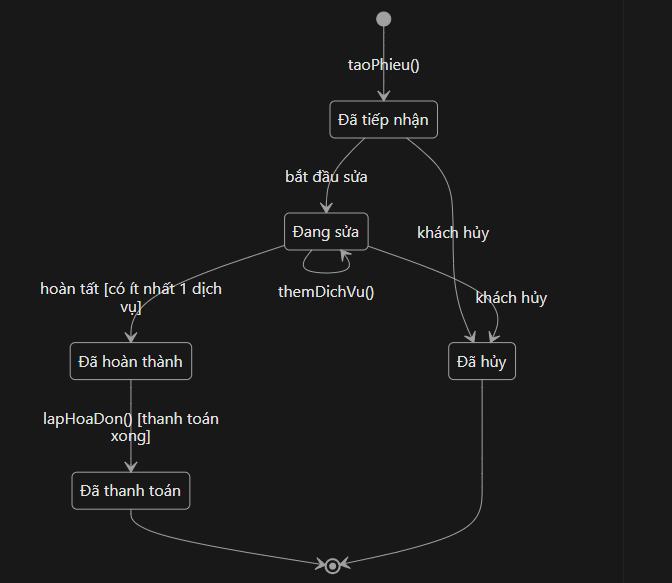

# Sơ đồ trạng thái (State Diagram)

Hệ thống quản lý cửa hàng bảo dưỡng – sửa chữa xe máy

## 1. Đối tượng được chọn: PhieuTiepNhan

Mỗi lần xe vào tiệm, hệ thống tạo 1 **phiếu tiếp nhận**. Phiếu này đi qua nhiều giai đoạn từ lúc nhận xe đến lúc khách trả tiền, và lớp `PhieuTiepNhan` có sẵn thuộc tính `trangThai`. Vì vậy đây là đối tượng phù hợp nhất để vẽ sơ đồ trạng thái.

## 2. Các trạng thái

| Trạng thái | Ý nghĩa | Giá trị `trangThai` |
|-----------|---------|---------------------|
| Đã tiếp nhận | Xe vừa vào tiệm, đã tạo phiếu, chưa bắt đầu làm | "Đã tiếp nhận" |
| Đang sửa | Thợ đang làm, nhân viên ghi dịch vụ vào phiếu | "Đang sửa" |
| Đã hoàn thành | Làm xong tất cả dịch vụ, chờ khách thanh toán | "Đã hoàn thành" |
| Đã thanh toán | Khách đã trả tiền, hóa đơn đã lập | "Đã thanh toán" |
| Đã hủy | Khách không làm nữa | "Đã hủy" |

## 3. Sơ đồ

## 4. Bảng chuyển trạng thái

| Từ trạng thái | Sự kiện | Điều kiện (guard) | Sang trạng thái | Hành động |
|---------------|---------|-------------------|-----------------|-----------|
| (bắt đầu) | Nhân viên nhận xe | Đã nhập thông tin khách và xe | Đã tiếp nhận | `taoPhieu()`: tạo phiếu, lưu ngày tiếp nhận |
| Đã tiếp nhận | Thợ bắt đầu sửa | Không có | Đang sửa | Cập nhật `trangThai` |
| Đang sửa | Thêm dịch vụ | Không có | Đang sửa (giữ nguyên) | `themDichVu()`: tạo thêm 1 `ChiTietDichVu` |
| Đang sửa | Làm xong | Phiếu có ít nhất 1 dịch vụ | Đã hoàn thành | Cập nhật `trangThai` |
| Đã hoàn thành | Khách thanh toán | Thanh toán thành công | Đã thanh toán | `lapHoaDon()`: tạo hóa đơn |
| Đã tiếp nhận hoặc Đang sửa | Khách hủy | Chưa lập hóa đơn | Đã hủy | Cập nhật `trangThai` |

## 5. Giải thích ký hiệu

| Ký hiệu | Ý nghĩa |
|---------|---------|
| `[*]` đầu sơ đồ | Điểm bắt đầu: đối tượng vừa được tạo ra |
| Hình bo tròn | Một **trạng thái**: giai đoạn mà đối tượng đang ở |
| Mũi tên | **Chuyển trạng thái**: đối tượng đổi từ trạng thái này sang trạng thái khác |
| Chữ trên mũi tên | **Sự kiện** làm đổi trạng thái (hoặc phương thức được gọi) |
| `[ ... ]` | **Điều kiện** (guard): phải đúng thì mới được chuyển |
| `[*]` cuối sơ đồ | Điểm kết thúc: phiếu không đổi trạng thái nữa |
| Mũi tên quay về chính nó | Sự kiện xảy ra nhưng trạng thái không đổi (thêm dịch vụ khi đang sửa) |

## 6. Liên hệ với sơ đồ lớp

- Thuộc tính `trangThai : String` của `PhieuTiepNhan` lưu trạng thái hiện tại.
- Các phương thức `taoPhieu()`, `themDichVu()` của `PhieuTiepNhan` và `lapHoaDon()` của `HoaDon` chính là những sự kiện làm phiếu đổi trạng thái.
- Phiếu đã ở trạng thái **Đã thanh toán** hoặc **Đã hủy** thì không được sửa nữa.
